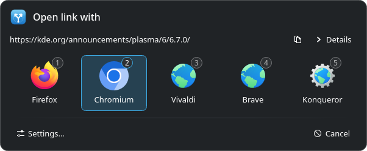
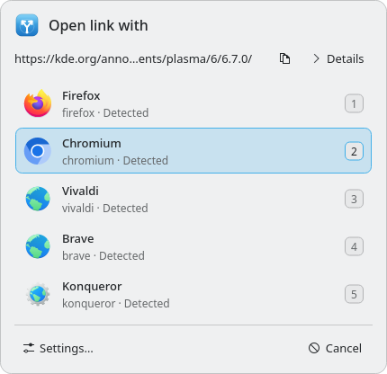
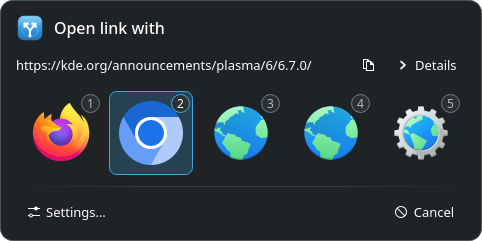
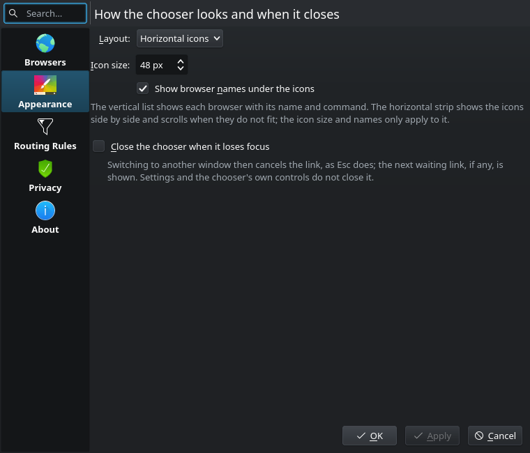

# Klinker

A native KDE Plasma link handler. Set it as your default web browser and every
link you open either goes straight to the browser chosen by your routing
rules, or shows a small chooser:

- a borderless, palette-themed card with your browsers, either as a horizontal
  strip of icons (the default; size and names configurable) or as a list with
  their names and commands; number keys 1–9 open the browser at that position,
  arrows and Enter or Space work, typing filters the browsers, Esc cancels, and
  optionally switching to another application cancels too;
- the link that will be opened (plain text, elided, with a copy button) and,
  under *Details*, the link as received and what preprocessing did;
- settings for browsers (detected automatically, plus your own), routing rules
  and two opt-in privacy features: removing tracking parameters and resolving
  redirects before choosing.

It is written in C++20 with Qt 6 Widgets and KDE Frameworks 6. Browsers are
started directly with an argument list, never through a shell. Functionality is
inspired by [Switchyard](https://github.com/alyraffauf/switchyard); no code or
assets are shared.

## Screenshots

  

*The horizontal strip with browser names, the default (Oxygen widget style, Breeze Dark colours).*

  
  

*The vertical list (Breeze Light) and the horizontal strip with icons only.*

  

*Appearance settings: layout, icon size, names and closing on focus loss.*

The screenshots are taken by the tests from synthetic browsers and links; see
[docs/usage.md](docs/usage.md#development).

## Building

Klinker targets KDE Plasma 6. It has been built and tested on Arch
Linux only, with these packages:

    sudo pacman -S --needed cmake ninja gcc qt6-base qt6-svg kconfig kwidgetsaddons kiconthemes layer-shell-qt desktop-file-utils

The minimum versions CMake checks for are Qt 6.5, KConfig 6.0,
KWidgetsAddons 6.10, KIconThemes 6.3 and LayerShellQt 6.6 (plus KColorScheme
for the tests). All of them are required; configuring fails if one is missing
or too old. Other distributions have not been tested; their packages must
provide at least these versions.

Build and run the tests:

    cmake -S . -B build -G Ninja -DCMAKE_BUILD_TYPE=Release && cmake --build build && ctest --test-dir build --output-on-failure

The tests run offscreen, never start a real browser and never touch your
configuration. See [docs/usage.md](docs/usage.md#development) for the Wayland
smoke tests and screenshots.

## Installing for your user

Nothing is installed or changed until you run these commands yourself.

    cmake -S . -B build -G Ninja -DCMAKE_BUILD_TYPE=Release -DCMAKE_INSTALL_PREFIX="$HOME/.local" && cmake --build build && cmake --install build

This installs:

- `~/.local/bin/klinker`
- `~/.local/share/applications/io.github.manicminer.Klinker.desktop`
- `~/.local/share/icons/hicolor/scalable/apps/io.github.manicminer.Klinker.svg`
- `~/.local/share/licenses/klinker/LICENSE`

To see what would be installed without installing anything, stage it inside
the build directory instead:

    DESTDIR="$PWD/build/stage" cmake --install build

The desktop file runs `klinker` from `PATH` (and uses `TryExec`,
so Plasma hides the entry if it cannot find the program). Check with
`command -v klinker`; if it prints nothing, add `~/.local/bin` to
the `PATH` of your Plasma session, for example with a script in
`~/.config/plasma-workspace/env/` containing `export PATH="$HOME/.local/bin:$PATH"`,
then log out and back in.

To try it without making it the default:

    klinker https://kde.org/

### Making it the default browser

*System Settings → Default Applications → Web browser*, then pick
**Klinker**. Switch back the same way.

Alternatively, from a terminal, note your current default first so you can
restore it:

    xdg-settings get default-web-browser

    xdg-settings set default-web-browser io.github.manicminer.Klinker.desktop

To restore, run `xdg-settings set default-web-browser` with the name the first
command printed (for example `firefox.desktop`). Before switching, open
Klinker once with `klinker --settings` and check that your browsers are
listed.

### Uninstalling

    xargs rm -v < build/install_manifest.txt

Your settings in `~/.config/klinker/` are left alone; delete the directory as
well to remove them.

## Usage

    klinker                  # settings
    klinker URL...           # route or choose, one link after another
    klinker --choose URL     # always show the chooser
    klinker --config FILE    # use another configuration file

Accepted links are `http`, `https` and `file` URLs, and paths of existing
files. Anything else (`javascript:`, `data:`, links with control characters
or whitespace other than plain spaces, ...) is refused with a message and exit status 2. More in
[docs/usage.md](docs/usage.md).

## Configuration

Settings live in `~/.config/klinker/config.json` (or under
`$XDG_CONFIG_HOME`), a versioned, human-readable JSON file documented in
[docs/configuration.md](docs/configuration.md). The settings window edits the
same file. Opening links never writes it; only *Apply* or *OK* in the settings
does, atomically, and only if nobody else changed the file since it was
loaded. While it does not exist, the defaults are used.

*Appearance* in the settings chooses between the horizontal strip of icons
(the default) and the vertical list, the strip's icon size and names, and
whether the chooser closes when it loses the focus.

Routing rules are checked from the top; the first enabled rule that matches
opens the link in its browser. For example:

| Type | Pattern | Matches |
|------|---------|---------|
| Domain | `docs.example.org` | exactly that host, any port, path or credentials |
| Domain and subdomains | `example.org` | `example.org`, `www.example.org`, `a.b.example.org`, not `notexample.org` |
| Wildcard | `https://github.com/my-org/*` | that organisation on GitHub (`*` also matches `/`) |
| Regular expression | `^https?://(www\.)?youtube\.com/` | POSIX extended regular expression, unanchored unless you anchor it |

A rule stores the target browser's ID, so renaming or reordering browsers does
not change where it goes. Rules may target hidden browsers. If the browser is
removed or uninstalled, the rule is shown with an error and skipped.

## Privacy and security

- No history, telemetry or network access by default.
- **Remove tracking parameters** (off by default) drops known tracking query
  parameters such as `utm_*`, `fbclid`, `gclid` and `msclkid`, keeping the
  rest of the link byte for byte. It applies before routing, before each
  redirect request and before the browser is started; the link shown, the
  link rules are checked against and the link the browser receives are always
  the same.
- Changing either privacy setting while a link is still waiting (being
  resolved, or in the chooser) starts that link again from the address as
  received, with the new settings. While the settings window is open no link
  is routed or opened; rules are applied once it closes.
- **Follow redirects** (off by default) contacts the link's server in the
  background *before you choose a browser*, which tells the server that the
  link was opened. At most three redirects are followed with `HEAD` requests
  (header-only `GET` when `HEAD` is refused); each request times out after 2
  seconds and the whole check after 15. No cookies or stored credentials
  are sent and only `http`/`https` targets without an https→http downgrade are
  followed. The chooser shows a busy state meanwhile and offers *Skip*. If the
  check fails, the chooser shows the last safe link and the reason; rules are
  not applied automatically in that case.
- Browsers are started with `QProcess` and an argument list. The link is
  always one argument (or substituted into the arguments containing `{url}`);
  commands that would hand it to a shell as code, or that would start Klinker
  itself, are refused.

## Limitations

- **Placement on Wayland.** A Wayland client cannot read the global pointer
  position before the pointer enters one of its own windows, and clients
  cannot position their windows. On Wayland the chooser is therefore a
  `wlr-layer-shell` surface (via LayerShellQt) without anchors, which the
  compositor centres on the output. The output is the one KWin reports as
  active over D-Bus (`org.kde.KWin /KWin activeOutputName`), otherwise the
  primary screen. It does not appear next to the pointer. On X11 the chooser
  is placed near the pointer and kept inside the screen's usable area.
  LayerShellQt is therefore a required dependency.
- Only Plasma (KWin) is supported; it has been tested on Plasma Wayland. Other
  desktops and compositors, in particular those without layer-shell support
  such as GNOME's, are not supported.
- Each link opens a separate process; there is no single-instance service.
  Several invocations at once are safe because nothing is written unless the
  settings are saved.
- The interface is English only.

## Licence

Klinker is released under the [MIT License](LICENSE). It is installed as
`share/licenses/klinker/LICENSE`. The licence covers Klinker's own code and
files only; Qt, KDE Frameworks, LayerShellQt and the browsers and icons it
shows are separate projects under their own licences.
